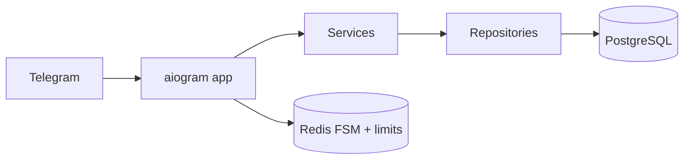

# PulseBot


**Privacy-minded Telegram task bridge** between clients and specialists. Both sides talk to the bot — not to each other’s accounts. Access is invite-code only.

## Why reviewers care

- Production-shaped **bot architecture**: handlers · services · repositories
- **Anonymity** via `copyMessage` / `file_id` relay (no username leakage)
- **Redis** rate limits + FSM storage
- Health endpoints, structured logging, graceful shutdown
- Docker Compose for Postgres + Redis + bot

## Features

- Invite codes with role + expiry (`ADMIN` / `CUSTOMER` / `DESIGNER`)
- FSM wizard for task creation (title → files → confirm)
- Status transitions enforced per role
- Anonymous comments (role attribution only)
- Deadline reminders · pagination · confirmation for destructive actions
- `/healthz` + `/readyz` for orchestration

## Stack

`Python 3.12` · `aiogram 3` · `SQLAlchemy 2` · `asyncpg` · `Alembic` · `PostgreSQL` · `Redis` · `Pydantic Settings` · `Docker`

## Architecture



## Quick start

```bash
cp .env.example .env
# set BOT_TOKEN from BotFather when you want a live bot

docker compose up --build
```

Without a real token the container still shows the intended topology; set `BOT_TOKEN` for an interactive demo.

## Layout

```
app/bot/           handlers, keyboards, middlewares, FSM
app/services/      business rules
app/repositories/  data access
app/db/models/     SQLAlchemy models
migrations/        Alembic
```

## License

MIT — portfolio / demonstration use. No personal chats or tokens are included.
